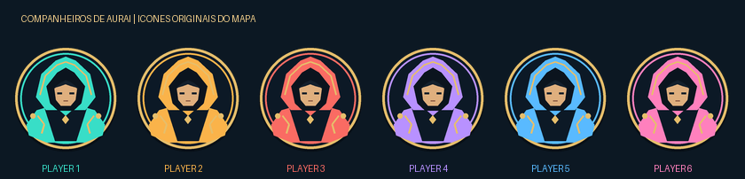

# Companheiros de Aurai — Outward Definitive Edition

Mod **experimental compilado** para a edição Steam **Mono**, Windows x64.
Adiciona uma **barra de busca no inventário e nos baús**, retratos com nome e
direção no mapa normal (**M**) e viagens do Caravaneiro Soroboriano entre cidades.
A tarifa é **200 pratas +
3 rações por viagem do grupo**, pagas por quem contrata.

**Ainda não validado em uma partida real, solo ou cooperativa.** Não temos
uma instalação de Outward neste ambiente. Compilação, referências DE,
testes de regras e testes com substitutos controlados não são testes do jogo.



## Instalação para você e seu irmão

**[Baixar pacote completo 0.2.0 — uma pasta para copiar](https://raw.githubusercontent.com/lucasmac412/Mods/outward-companheiros-completo-v0.2.0/downloads/Outward-Companheiros-v0.2.0-Completo.zip)**

Este pacote reúne o mod e o carregador BepInExPack_Outward com `mono_fix`.
Não precisa baixar o carregador separadamente, usar PowerShell ou abrir instalador.

1. Com o jogo fechado, na Steam: **Outward → Propriedades → Betas →
   `default-mono - Public default branch (mono)`**. Aguardem a atualização.
2. Extraiam o ZIP e abram a pasta **`transfere pro jogo`**.
3. Na Steam: **Outward → Propriedades → Arquivos instalados → Explorar**.
   Abram **`Outward_Defed`**, onde fica `Outward Definitive Edition.exe`.
4. Copiem **tudo que está dentro** de `transfere pro jogo` para `Outward_Defed`.
   Abram a **Definitive Edition pela Steam** normalmente. Repitam nos **dois PCs**.

O [guia do pacote completo](LEIA-ME-COMPLETO.txt) também vai dentro da pasta.
A versão experimental **0.2.0** acrescenta busca ao mapa e às caravanas da
0.1.0. A versão Mono ainda precisa ser selecionada na Steam.
Se já usam r2modman ou outro gerenciador, mantenham a instalação do gerenciador
e usem o pacote só do plugin descrito abaixo.

### Alternativa: pacote somente do plugin

Repitam os passos **nos dois computadores**. Não precisa programar ou usar
PowerShell. O ZIP anterior somente do mod contém a própria DLL, o guia e as licenças;
o BepInEx oficial é um download separado.

1. Fechem o jogo. Na Steam, botão direito em **Outward → Propriedades → Betas**.
   Selecionem **`default-mono - Public default branch (mono)`** e aguardem a atualização.
2. Em **Arquivos instalados → Explorar**, abram **`Outward_Defed`**.
   Deve haver **`Outward Definitive Edition.exe`** nessa pasta.
3. Se ainda não usam BepInEx, baixem o [BepInExPack_Outward 5.4.19 para Windows x64](https://gcdn.thunderstore.io/live/repository/packages/BepInEx-BepInExPack_Outward-5.4.19.zip).
   Extraiam o ZIP, abram a pasta **`BepInExPack_Outward`** e copiem seu
   conteúdo (`BepInEx`, **`mono_fix`**, `winhttp.dll` e `doorstop_config.ini`)
   para `Outward_Defed`. Abram a
   Definitive Edition uma vez pela Steam e fechem: deve aparecer
   `BepInEx/LogOutput.log`. **Mantenham BepInEx 5 existente se já funciona com
   o `mono_fix` do Outward.** O pacote genérico sem esse ajuste não é o indicado.
4. Baixem o [ZIP do mod](https://raw.githubusercontent.com/lucasmac412/Mods/outward-companheiros-v0.2.0-experimental/downloads/Outward-Companheiros-v0.2.0-Experimental.zip),
   usem **Extrair tudo** e abram a pasta extraída até ver `BepInEx`.
   Copiem essa pasta para `Outward_Defed`, mesclando as pastas.
5. Confiram o caminho final:
   `Outward_Defed/BepInEx/plugins/CompanheirosAurai/Outward.Companheiros.dll`.
   Iniciem a **Definitive Edition** e entrem na mesma partida como de costume.

O [passo a passo completo](LEIA-ME.txt) está também dentro do ZIP, incluindo
instalação com r2modman, resolução de problemas e desinstalação. Não exige SideLoader.

## Como usar

- **Busca:** cliquem na barra **BUSCAR ITENS** no inventário, baú ou recipiente
  aberto. Tem fundo escuro, contorno dourado e a fonte nativa da interface.
  Procura parte do nome no idioma do jogo, ignorando maiúsculas e acentos:
  `pocao` encontra `Poção`; `vida grande` encontra `Grande Poção de Vida`.
  O inventário e o baú usam campos independentes. A busca respeita a categoria
  selecionada; escolham **Todos** para procurar em todo o inventário.
- **Limpar:** **×** mostra novamente os itens da categoria. **Enter** encerra
  a digitação; fechar o painel limpa o texto. A contagem é de ícones/grupos
  visíveis. Cada jogador tem sua própria pesquisa, sem sincronizar o texto
  com os outros. A busca não altera os itens armazenados.
- **Pegar tudo:** limpem a busca antes de usar essa ação. Com busca ativa ela
  fica bloqueada com uma mensagem, evitando recolher itens ocultos. A
  transferência individual continua usando os controles normais do jogo.
- **Mapa:** apertem **M**. Retratos, nomes e setas acompanham os personagens
  nas regiões com mapa calibrado. A lista mostra todos os jogadores da sessão,
  incluindo quem ainda carrega o personagem. Caídos têm indicação. Cores
  permanecem iguais entre os computadores pela identidade do personagem.
- **Viagens:** falem com o **Caravaneiro Soroboriano dentro de uma cidade** e
  escolham viajar. A lista oferece Cierzo, Berg, Monsoon, Levant e Harmattan,
  exceto o destino atual e cidades bloqueadas pela história. Nova Sirocco é
  incluída quando sua caravana for liberada pela campanha.
- **Cooperativo:** reúnam todos perto do NPC. Quem contrata carrega as 200
  pratas e 3 rações; o jogo faz a cobrança e leva o grupo pelo carregamento
  cooperativo normal. Solo usa o mesmo procedimento. A tarifa fixa das
  novas rotas não recebe desconto de facção. Passam **3 dias no jogo**,
  incluindo os prazos de missões, como na viagem original.

Interiores sem mapa calibrado mostram a lista, sem um ponto inventado em
outra região. Caravanas fora das cidades mantêm o funcionamento original.
O mod não aumenta o limite de jogadores do jogo; se outro mod o aumentar,
a lista não tem um limite fixo de duas pessoas.

Na primeira execução é criado `BepInEx/config/lucasmac412.outward.companheiros.cfg`:
`MarcadoresNoMapa`, `CaravanasEntreCidades` e `BuscaNoInventarioEBaus`
ligam/desligam as funções.
Façam o primeiro teste em uma cópia dos saves, sozinhos e juntos.

## Desenvolvimento e validação

Requer .NET SDK 8. Referências públicas fixadas para DE:
`Outward.GameLibs 2022.5.18-r.0`, `UnityEngine.Modules 2020.3.26`,
`BepInEx.BaseLib 5.4.19`, `HarmonyX 2.9.0`. Bibliotecas do jogo não são
distribuídas. O pacote completo inclui o carregador oficial sem modificar suas
DLLs; o pacote anterior contém apenas o plugin.

```sh
dotnet build src/Outward.Companheiros.csproj -c Release
dotnet run --project tests/Tests.csproj -c Release
dotnet run --project tests/Adapter/Adapter.csproj -c Release
dotnet run --project tools/Contracts/Contracts.csproj -c Release -- /caminho/Assembly-CSharp.dll src/bin/Release/net472/Outward.Companheiros.dll
python3 tools/package.py
# Reúne os dois ZIPs publicados, conferindo os SHA-256 fixados:
python3 tools/package_complete.py
```

`tests/Adapter` executa o **mesmo `Caravan.cs`** do plugin contra substitutos
controlados, sem Unity/jogo/rede. `Contracts` lê metadados, verifica os
encaixes DE e rejeita acessos diretos a membros privados das referências
publicizadas. Verifica também os sete PNGs embutidos e suas assinaturas.
Os resultados ficam na [ação de compilação](https://github.com/lucasmac412/Mods/actions/workflows/outward.yml).

O [relatório do pacote](docs/build.json) registra a compilação Windows e
o SHA-256 desta entrega. Os testes incluem acentos e caixa, palavras em
qualquer ordem, composição com filtros nativos, campos independentes e
cache limitado. A inspeção de IL cobre também classes e lambdas aninhadas,
encaixes de inventário/baú, reconhecimento de entrada de texto e ausência
de chamadas de alteração de inventário ou rede nas classes de busca.
Os testes de partida solo/cooperativa permanecem **não realizados**.

Não há patches de inventário, escrita de arquivos do jogo, protocolo de
teleporte paralelo ou alteração dos RPCs de cobrança/transição. A lista de
rotas é produzida quando o diálogo nativo a pede, tanto no anfitrião quanto
no convidado, evitando depender da lista de um único destino da caravana.

O teste real pendente está descrito em [VALIDACAO.md](docs/VALIDACAO.md).
Pesquisa e licenças: [RESEARCH.md](docs/RESEARCH.md), [LICENSES.txt](LICENSES.txt).
O pacote completo preserva as licenças dos componentes em
[LICENSES-COMPLETO.txt](LICENSES-COMPLETO.txt), com origem e versões registradas
no [relatório do pacote completo](docs/build-completo.json).
